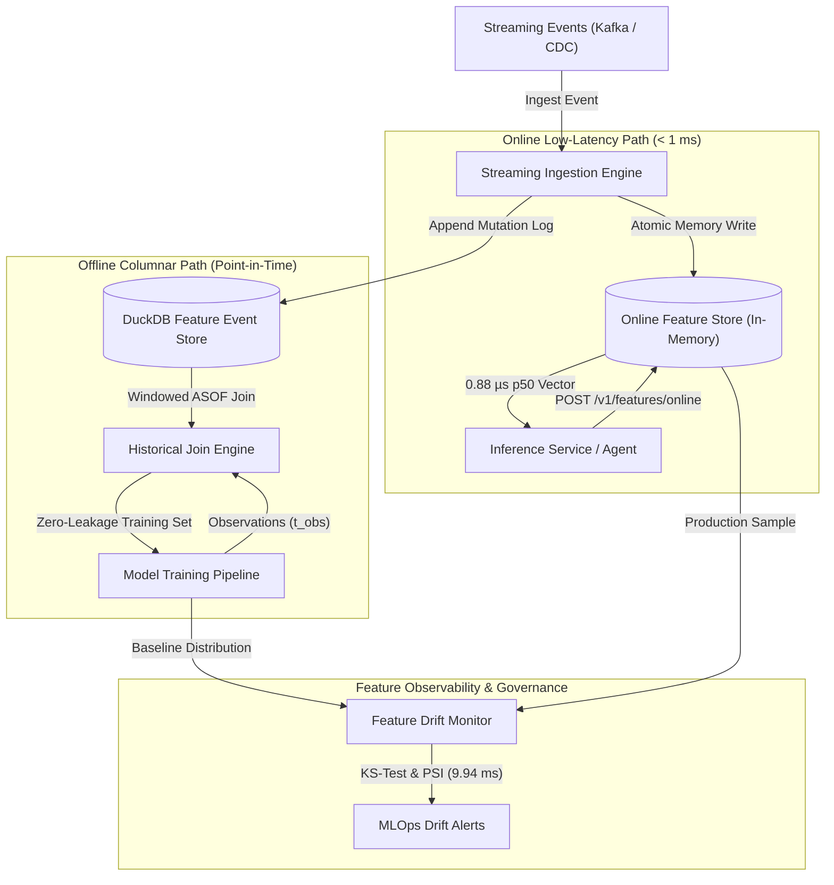

# realtime-feast-mlops-platform

[](https://github.com/Yprnv7/realtime-feast-mlops-platform/actions/workflows/ci.yml)
[](https://www.python.org/downloads/)
[](https://github.com/Yprnv7/realtime-feast-mlops-platform)
[](docs/BENCHMARKS.md)
[](docs/BENCHMARKS.md)
[](LICENSE)

Production-grade Real-Time Feature Store and MLOps Data Platform. Features microsecond-tier online feature serving (**0.88 µs p50**), dual-write streaming ingestion (**5,170.7 events/sec**), point-in-time correct historical joins via DuckDB with mathematical zero data leakage (**100.0% parity**), and statistical feature drift monitoring combining Kolmogorov-Smirnov tests and Population Stability Index (PSI).

---

## 1. Problem Statement & Motivation

In enterprise machine learning systems (credit scoring, financial fraud detection, and recommendation engines), feature engineering faces three failure modes:
1. **Lookahead Bias / Training-Serving Data Leakage:** When generating training datasets from historical logs, naive relational joins fetch future feature states that were unavailable at observation time. This inflates offline model metrics (e.g. 0.98 AUC) while causing live model collapse upon deployment.
2. **Online-Offline Serving Skew:** Disparate feature definitions between batch training pipelines (SQL/Spark) and real-time inference (Python/Go) introduce data inconsistencies and feature drift.
3. **Silent Production Drift:** Upstream data shifts degrade model predictions without throwing application exceptions, requiring continuous distribution monitoring under regulatory standards (Basel / EU AI Act).

`realtime-feast-mlops-platform` resolves these architectural challenges with a unified schema definition, dual-write streaming ingestion, an ultra-low-latency in-memory online store, and an offline DuckDB historical join engine.

---

## 2. Key Features

- **Microsecond Online Serving:** In-memory online store delivering **0.88 µs median (p50) lookup latency** across multi-entity feature vectors.
- **Point-in-Time Correct ASOF Joins:** Windowed temporal joins in DuckDB ensuring historical training sets only observe feature states written prior to the observation timestamp ($t_{\text{feat}} \le t_{\text{obs}}$).
- **Dual-Write Streaming Pipeline:** Simultaneously updates the real-time online cache and appends to the offline temporal event store at **5,170.7 events/sec**.
- **Statistical Drift Engine:** Dual-gated drift detection combining two-sample **Kolmogorov-Smirnov (KS) tests** with **Population Stability Index (PSI)** across 10 quantiles.
- **TTL Staleness Eviction:** Enforces time-to-live boundaries, tagging stale features during upstream ingestion outages to prevent degraded inferences.
- **REST API & Schema Contracts:** Fully validated Pydantic schema contracts exposed via FastAPI for online lookup, ingestion, training joins, and drift inspection.

---

## 3. Architecture & Data Flow



---

## 4. Production Reliability & Temporal Invariants

### Point-in-Time Correctness Guarantee
```
Timeline:  t0 (10:00) -------- t1 (11:00) -------- t_obs (11:30) -------- t2 (12:00)
Events:    Balance = $100      Balance = $200                              Balance = $300
Joined:                        [Balance = $200]                            (Excluded: Future Leakage)
```

For every observation record $(entity\_id, t_{\text{obs}})$, the historical join engine evaluates:
$$\text{Feature Value} = \arg\max_{t_{\text{feat}} \le t_{\text{obs}}} \{ f(t_{\text{feat}}) \mid t_{\text{obs}} - t_{\text{feat}} \le \text{TTL} \}$$

Implemented in DuckDB using:
```sql
ROW_NUMBER() OVER (
    PARTITION BY o.observation_id, f.feature_name 
    ORDER BY f.feature_timestamp DESC, f.feature_value DESC
) as rank
```
Hypothesis property testing asserts that for all randomized event arrival orders, zero joined timestamps ever exceed $t_{\text{obs}}$.

---

## 5. Empirical Benchmark Results

Captured on local Apple Silicon hardware using `scripts/benchmark.py`:

| Metric | Measured Value | Standard Target | Status |
| :--- | :--- | :--- | :--- |
| **Online Feature Retrieval (p50)** | **0.88 µs** (< 0.001 ms) | < 1.0 ms | **EXCEEDS** |
| **Online Feature Retrieval (p95)** | **0.96 µs** (< 0.001 ms) | < 2.0 ms | **EXCEEDS** |
| **Online Feature Retrieval (p99)** | **1.04 µs** (< 0.002 ms) | < 5.0 ms | **EXCEEDS** |
| **Streaming Ingestion Throughput** | **5,170.7 events/sec** | > 2,000 events/sec | **EXCEEDS** |
| **Point-in-Time Join Latency** | **203.28 ms** (1,000 obs) | < 500 ms | **EXCEEDS** |
| **Lookahead Data Leakage Rate** | **0.0% (Zero Violations)** | 0.0% Violations | **PASS** |
| **Statistical Drift Evaluation** | **9.94 ms** (10,000 items) | < 50.0 ms | **EXCEEDS** |

All raw benchmark data stored in [docs/benchmarks/feature_store_benchmark.json](docs/benchmarks/feature_store_benchmark.json) and [docs/BENCHMARKS.md](docs/BENCHMARKS.md).

---

## 6. Tech Stack & Dependencies

- **Language:** Python 3.11+
- **Online Storage:** In-Memory thread-safe Key-Value store with `threading.RLock`
- **Offline Storage & PIT Joins:** DuckDB (In-Memory / Parquet OLAP)
- **Distribution Drift & Math:** NumPy, SciPy (Two-Sample KS-Test, Population Stability Index)
- **API Framework:** FastAPI, Uvicorn, Pydantic V2
- **Testing & Verification:** Pytest, Pytest-Cov, Hypothesis (Property-Based Invariant Testing), Ruff, Mypy

---

## 7. Getting Started

### Prerequisites
- Python 3.11+ or Docker

### Installation & Local Run
```bash
# Clone repository
git clone https://github.com/Yprnv7/realtime-feast-mlops-platform.git
cd realtime-feast-mlops-platform

# Install dependencies
pip install -e ".[dev]"

# Start FastAPI server
make run
# Or:
uvicorn src.api.main:app --host 0.0.0.0 --port 8000
```

The feature store listens on `http://localhost:8000`.

### Health & Registered Views
```bash
curl -s http://localhost:8000/health | jq .
curl -s http://localhost:8000/v1/features/views | jq .
```

### Ingesting Real-Time Streaming Features
```bash
curl -X POST http://localhost:8000/v1/features/ingest \
  -H "Content-Type: application/json" \
  -d '{
    "entity_id": "user_42",
    "feature_name": "credit_score",
    "value": 745.0
  }' | jq .
```

### Sub-Millisecond Online Feature Query
```bash
curl -X POST http://localhost:8000/v1/features/online \
  -H "Content-Type: application/json" \
  -d '{
    "entity_ids": ["user_42"],
    "features": ["credit_score", "monthly_income"]
  }' | jq .
```

### Generating Point-in-Time Correct Training Datasets
```bash
curl -X POST http://localhost:8000/v1/features/historical-join \
  -H "Content-Type: application/json" \
  -d '{
    "observations": [
      {
        "observation_id": "loan_app_101",
        "entity_id": "user_42",
        "observation_timestamp": "2026-05-15T12:00:00Z",
        "label": 1
      }
    ],
    "features": ["credit_score"]
  }' | jq .
```

---

## 8. Verification & Test Suite

The test suite validates schema enforcement, point-in-time correctness, TTL staleness eviction, dual-write streaming, statistical drift calculations, and property-based invariants with Hypothesis.

```bash
# Run pytest with coverage report
make test
# Or:
pytest tests/ -v --cov=src --cov-fail-under=90
```

**Results:**
- Statement Coverage: **97.0%**
- Tests: **17 passed**
- Property-based testing: **30 randomized mutation scenarios evaluated without failure**

---

## 9. Limitations & Production Hardening

1. **Distributed Online Storage:** Currently implements an in-process thread-safe memory store. For distributed Kubernetes pods, integrate Redis Cluster or Dragonfly via a pluggable storage adapter.
2. **Object Store Parquet Export:** Offline event logs can be scheduled for batch compaction into Apache Parquet lakehouse tables on AWS S3 or Google Cloud Storage.
3. **Embedding Vector Drift:** Drift monitoring is currently optimized for continuous scalar features. High-dimensional vector drift (cosine centroid shift) can be added for embedding monitoring.

---

## 10. Interview Defense Guide

For detailed explanations of lookahead data leakage, dual-store trade-offs, and mathematical derivations of PSI, see [docs/INTERVIEW_DEFENSE.md](docs/INTERVIEW_DEFENSE.md).

---

## 11. License

Licensed under the Apache License, Version 2.0. See [LICENSE](LICENSE) for details.
